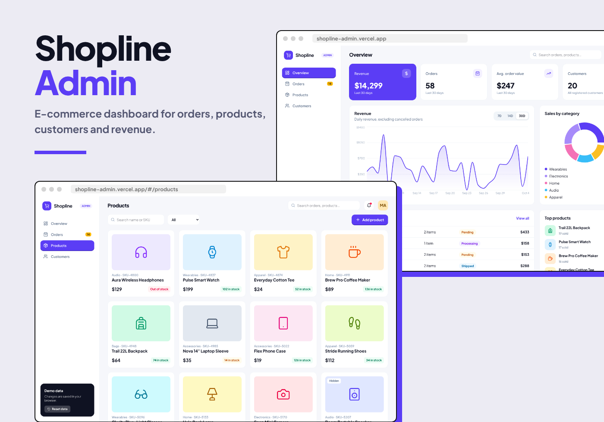
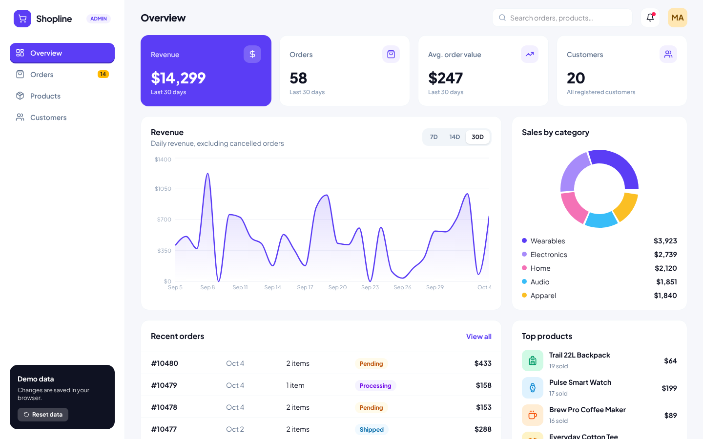
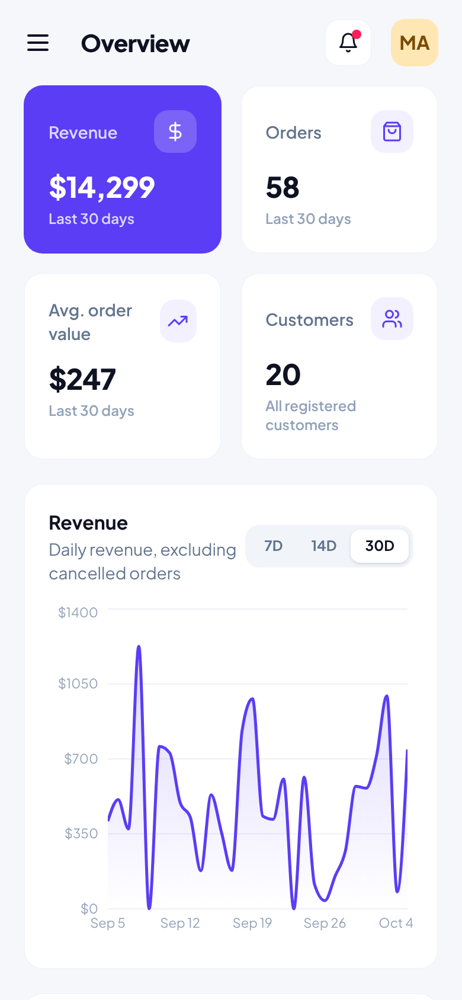
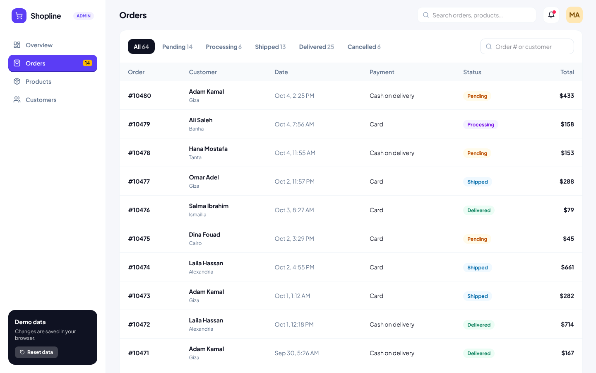
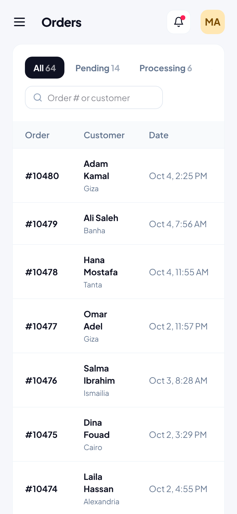
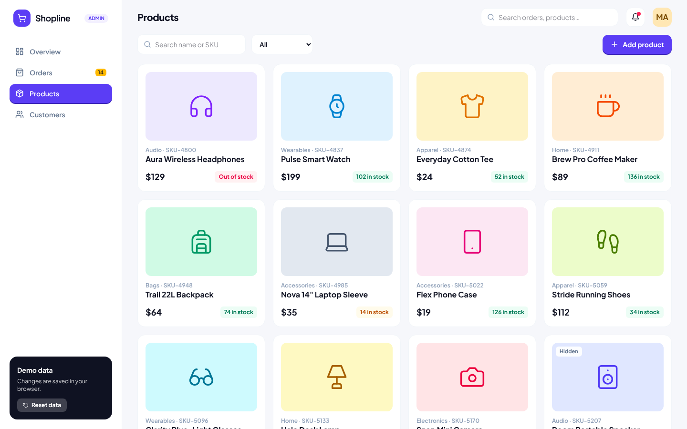
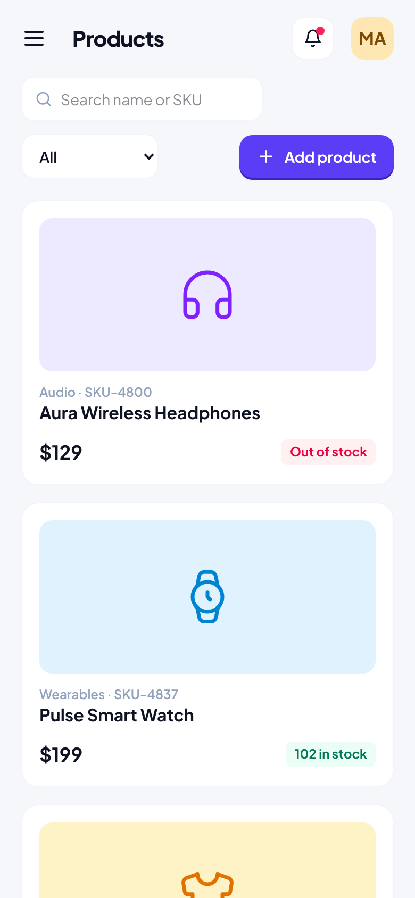
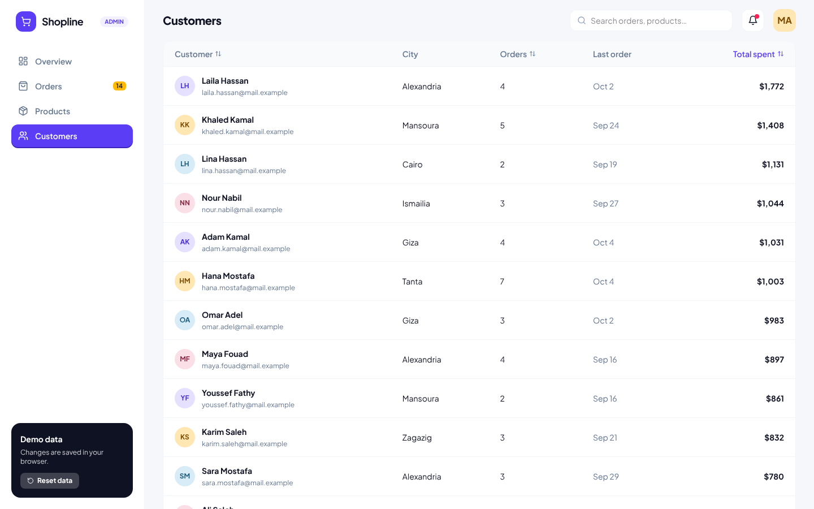
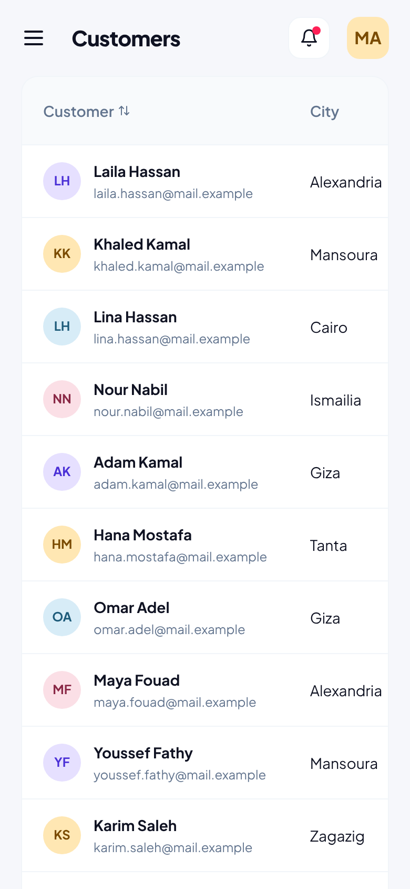

# Shopline Admin

A responsive e-commerce operations dashboard for monitoring performance and managing orders, products, inventory, and customers.



> Shopline Admin is an independent portfolio concept. The store, products, orders, customers, and financial data are fictional.

## What it demonstrates

- Product thinking across connected e-commerce workflows
- Derived analytics from normalized order, product, and customer data
- CRUD operations with validation and persistent browser state
- Responsive data-heavy interfaces for desktop and mobile
- Reusable tables, filters, forms, drawers, charts, and status controls

## Core features

### Performance overview

- Revenue, order count, and average order value for 7-, 14-, and 30-day periods
- Comparisons with the preceding period
- Revenue trend, sales by category, and top-product visualizations
- Metrics derived from the underlying mock order data

### Order operations

- Search and status-based filtering
- Order-detail drawer with customer data and line items
- Workflow transitions across Pending, Processing, Shipped, Delivered, and Cancelled states

### Product and inventory management

- Add, edit, and delete product records
- Validation for product name, price, and stock quantity
- Category filters, search, and low-stock indicators

### Customer insights

- Sortable customer directory
- Per-customer order count and total-spend calculations
- Cancelled orders excluded from commercial totals

## Demo data and persistence

The application starts with deterministic sample data—12 products, 20 customers, and 64 orders—so analytics remain consistent between evaluations. User changes are persisted through `localStorage`, with support for resetting the demo state.

## Tech stack

- React 18
- Vite 6
- Tailwind CSS 4
- React Router 6
- Recharts
- Lucide React
- Browser `localStorage`

## Application routes

| Route | Purpose |
| --- | --- |
| `/` | Revenue and sales overview |
| `/orders` | Order search, details, and status management |
| `/products` | Product catalog and inventory management |
| `/customers` | Customer activity and spend insights |

## Run locally

```bash
npm install
npm run dev
```

To verify the production build:

```bash
npm run build
npm run preview
```

## Screenshots

| Page | Desktop | Mobile |
| --- | --- | --- |
| Overview |  |  |
| Orders |  |  |
| Products |  |  |
| Customers |  |  |

## Current scope

This repository is a frontend concept. It does not process real payments or connect to a commerce backend. A production implementation would add authentication and role-based permissions, server-side APIs, transactional database operations, inventory safeguards, payment and fulfillment integrations, audit logs, and monitoring.

## Author

**Mohamed Ashraf** 
